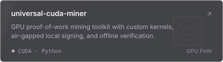
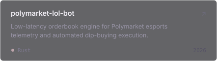
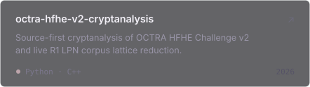
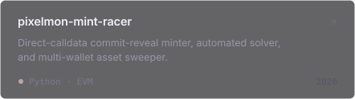
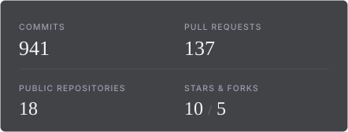
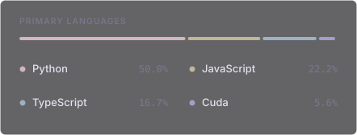

  

    

  

    

  

  <table border="0" cellspacing="0" cellpadding="0" width="100%">
    <tr>
      <td width="50%" align="left" valign="top">
        
      </td>
      <td width="50%" align="right" valign="top">
        
      </td>
    </tr>
    <tr>
      <td width="50%" align="left" valign="top">
        
      </td>
      <td width="50%" align="right" valign="top">
        
      </td>
    </tr>
  </table>

   

  

  <table border="0" cellspacing="0" cellpadding="0" width="100%">
    <tr>
      <td width="50%" align="left" valign="top">
        
      </td>
      <td width="50%" align="right" valign="top">
        
      </td>
    </tr>
  </table>

   

  

  <picture>
    <source media="(prefers-color-scheme: dark)" srcset="https://raw.githubusercontent.com/asbryx/asbryx/output/github-contribution-grid-snake-dark.svg">
    <source media="(prefers-color-scheme: light)" srcset="https://raw.githubusercontent.com/asbryx/asbryx/output/github-contribution-grid-snake.svg">
    
  </picture>

    

  

