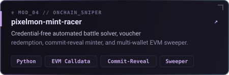
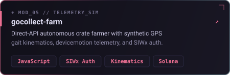
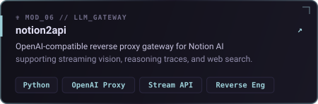

  <!-- HERO BANNER -->
  

    

  <!-- TYPING HEADER -->
  

  <!-- CYBER-SIGILISM BIO QUOTE CARD -->
  

    

  <!-- STATUS & IDENTITY BADGES -->
  

    
    
    
    
  

 

<!-- OPERATIONAL ARCHITECTURE -->

  

 

---

### `✟` ARSENAL & RUNTIME STACK

   
  
    

---

### `✟` DEPLOYED MODULES & RESEARCH

  <table border="0" cellspacing="0" cellpadding="0" width="100%">
    <tr>
      <td width="50%" align="center" valign="top">
        
      </td>
      <td width="50%" align="center" valign="top">
        
      </td>
    </tr>
    <tr>
      <td width="50%" align="center" valign="top">
        
      </td>
      <td width="50%" align="center" valign="top">
        
      </td>
    </tr>
    <tr>
      <td width="50%" align="center" valign="top">
        
      </td>
      <td width="50%" align="center" valign="top">
        
      </td>
    </tr>
  </table>

---

### `✟` SYSTEM TELEMETRY & LANGUAGE KERNEL

  <table border="0" cellspacing="0" cellpadding="0" width="100%">
    <tr>
      <td width="50%" align="center" valign="top">
        
      </td>
      <td width="50%" align="center" valign="top">
        
      </td>
    </tr>
  </table>

---

### `✟` CONTRIBUTION MATRIX

  <picture>
    <source media="(prefers-color-scheme: dark)" srcset="https://raw.githubusercontent.com/asbryx/asbryx/output/github-contribution-grid-snake-dark.svg">
    <source media="(prefers-color-scheme: light)" srcset="https://raw.githubusercontent.com/asbryx/asbryx/output/github-contribution-grid-snake.svg">
    
  </picture>

 

  ✦ <em>“people who have seen hell often appreciate heaven the most”</em> — <a href="https://github.com/asbryx"><b>asbryx</b></a> ✦

 
