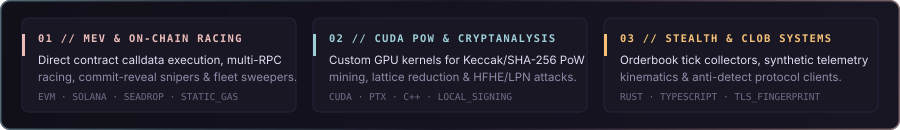
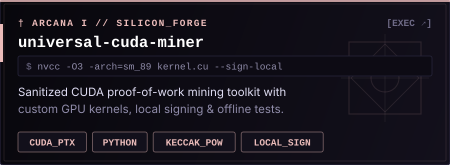
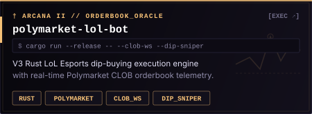
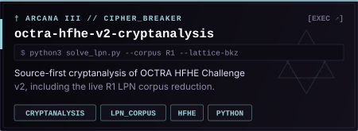
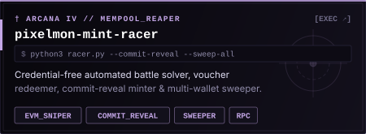
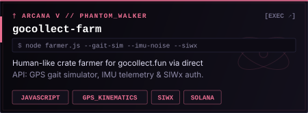
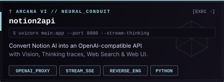
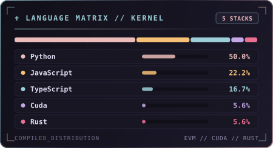

  <!-- HERO COLLAGE BANNER -->
  

    

  <!-- SACRAMENTAL ALTAR & BIO RELIQUARY (ANIMATED SVG) -->
  

    

  <!-- SYSTEM SCHEMATICS // EXECUTION TRIAD -->
  

    

  

  <b>† DEPLOYED ARCANA // PUBLIC ARTIFACTS †</b>

 

  <table border="0" cellspacing="0" cellpadding="0" width="100%">
    <tr>
      <td width="50%" align="center" valign="top">
        
      </td>
      <td width="50%" align="center" valign="top">
        
      </td>
    </tr>
    <tr>
      <td width="50%" align="center" valign="top">
        
      </td>
      <td width="50%" align="center" valign="top">
        
      </td>
    </tr>
    <tr>
      <td width="50%" align="center" valign="top">
        
      </td>
      <td width="50%" align="center" valign="top">
        
      </td>
    </tr>
  </table>

  
  <b>† MEMPOOL OSCILLOSCOPE &amp; KERNEL ALLOCATION †</b>

 

  <table border="0" cellspacing="0" cellpadding="0" width="100%">
    <tr>
      <td width="50%" align="center" valign="top">
        
      </td>
      <td width="50%" align="center" valign="top">
        
      </td>
    </tr>
  </table>

  
  <b>† TEMPORAL COMMIT TRACE †</b>

 

  <picture>
    <source media="(prefers-color-scheme: dark)" srcset="https://raw.githubusercontent.com/asbryx/asbryx/output/github-contribution-grid-snake-dark.svg">
    <source media="(prefers-color-scheme: light)" srcset="https://raw.githubusercontent.com/asbryx/asbryx/output/github-contribution-grid-snake.svg">
    
  </picture>

 

  † <em>“people who have seen hell often appreciate heaven the most”</em> · <a href="https://x.com/asbryx"><b>@asbryx</b></a> †

