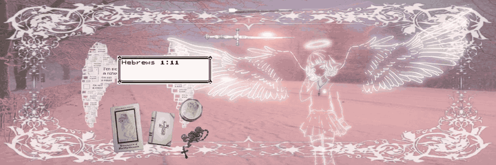

  

    

  

    

  

  <table border="0" cellspacing="0" cellpadding="0" width="100%">
    <tr>
      <td width="50%" align="left" valign="top">
        
      </td>
      <td width="50%" align="right" valign="top">
        
      </td>
    </tr>
    <tr>
      <td width="50%" align="left" valign="top">
        
      </td>
      <td width="50%" align="right" valign="top">
        
      </td>
    </tr>
  </table>

   

  

  <table border="0" cellspacing="0" cellpadding="0" width="100%">
    <tr>
      <td width="50%" align="left" valign="top">
        
      </td>
      <td width="50%" align="right" valign="top">
        
      </td>
    </tr>
  </table>

    

  

